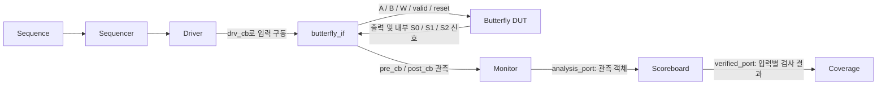
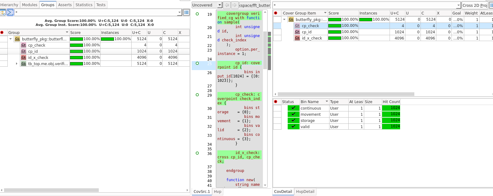

# Butterfly Pipeline UVM Verification

3단 파이프라인 복소수 Butterfly RTL을 검증하는 SystemVerilog/UVM 테스트벤치입니다. 초기 reset 후 랜덤 입력 **1,024개를 공백 없이 연속 전달**하고, 각 입력이 S0 → S1 → S2를 통과하는 동안 저장값, 단계 이동, valid 정렬, 연속 처리를 확인합니다.

검증 실행 결과, 입력과 출력 각각 **1,024개**, 네 검증 항목 각각 **1,024 hit**, 입력 ID × 검증 항목의 **4,096개 cross bin 충족**을 확인했습니다. 해당 실행의 UVM_ERROR와 UVM_FATAL은 모두 0건입니다.

## 1. DUT 구성

Butterfly는 복소수 입력 A, B와 계수 W를 받아 다음 연산을 수행합니다.

```text
T  = B × W
Y0 = A + T
Y1 = A − T
```

| 단계 | 저장하는 값 | 입력 수락 에지 기준 |
| --- | --- | --- |
| S0 | A, B, W | E0 |
| S1 | 지연된 A, 복소 곱셈 결과 T | E1 |
| S2 | Y0, Y1 | E2 |

파이프라인은 매 클럭 새로운 입력을 수락합니다. 한 입력은 S0에 저장된 에지로부터 두 클럭 뒤 S2에 도달하며, 연속 입력 구간에는 파이프라인이 채워진 뒤 매 클럭 결과가 나옵니다.

| 항목 | 설정 |
| --- | --- |
| A/B 실수부·허수부 | 각각 signed 20비트 |
| W 실수부·허수부 | 각각 signed 16비트, 소수부 14비트 |
| `twiddle_factor` | `{W_real, W_imag}`, 총 32비트 |
| T 실수부·허수부 | 각각 signed 21비트 |
| Y0/Y1 실수부·허수부 | 각각 signed 20비트 |
| 테스트 클럭 | 10 ns 주기, 100 MHz |
| 입력 개수 | 1,024개 |

## 2. UVM 검증 구조



`Test`는 테스트 실행과 종료를 관리합니다. `Env`는 Agent, Scoreboard, Coverage를 생성·연결하고, Agent는 Sequencer, Driver, Monitor를 포함합니다. `tb_top`은 DUT와 interface를 인스턴스화하고, 내부 신호를 계층 참조로 interface에 연결합니다.

| 구성요소 | 역할 |
| --- | --- |
| Item | 랜덤 입력, 입력 ID, 관측값, 검증 결과를 담는 공통 클래스 |
| Sequence | 입력 객체 1,024개 생성 및 랜덤화 |
| Sequencer | Sequence와 Driver 사이의 항목 전달 조정 |
| Driver | 초기 reset 및 연속 입력 구동, 마지막 입력 후 valid 해제 |
| Interface | DUT 신호와 구동·관측용 clocking block 제공 |
| Virtual interface | UVM 클래스에서 실제 interface에 접근하기 위한 참조 |
| Monitor | 매 클럭 실제 입력과 각 단계의 저장값·valid 관측 |
| Scoreboard | 독립 기대값 계산, 실제 값 비교, 입력별 검사 결과 전달 |
| Coverage | 전달받은 성공 항목을 입력 ID별 bin에 누적 |

### 공통 Item 사용

Sequence와 Monitor는 모두 `butterfly_item` 타입을 사용하지만, **서로 다른 객체를 생성**합니다.

| 구분 | 입력 객체 | 관측 객체 |
| --- | --- | --- |
| 생성 위치 | Sequence | Monitor |
| 주요 내용 | 랜덤 A/B/W, `transaction_id` | 실제 입력, 단계별 저장값, valid, `cycle_id` |
| 랜덤화 | 수행 | 수행하지 않음 |
| 전달 경로 | Sequencer → Driver | Monitor → Scoreboard |

Scoreboard도 같은 타입으로 결과 객체를 생성하여 `transaction_id`, `cycle_id`, `verified_checks`를 Coverage에 전달합니다. 별도의 observation 클래스나 구조체 파일은 사용하지 않습니다.

### Analysis port 사용

Analysis port는 UVM TLM 통신 방식 중 하나입니다. Monitor는 `write()` 함수로 관측 객체를 전달하고, Scoreboard는 전달받은 필드를 직접 읽어 비교합니다. 시간 대기 없이 관측 결과를 배포하는 현재 구조에 사용했습니다.

Analysis port 자체는 객체를 복제하거나 저장하지 않습니다. Monitor는 매 클럭 새 객체를 생성하며, 관측 필드의 자동 `copy()`·`clone()`에 의존하지 않습니다.

## 3. 입력 구동과 관측 시점

| 접근 경로 | 사용 주체 | 동작 |
| --- | --- | --- |
| `vif.drv_cb` | Driver | 하강 에지에서 다음 입력과 valid 구동 |
| `vif.pre_cb` | Monitor | 상승 에지 직전의 reset, 입력 valid, A/B/W 샘플링 |
| `vif.post_cb` | Monitor | 상승 에지의 레지스터 갱신 후 S0/S1/S2 및 valid 샘플링 |

Driver는 초기 reset 후 1,024개 입력을 연속 전달합니다. 입력 사이에 의도적인 valid 공백은 넣지 않으며, 마지막 입력 수락 후 valid를 해제합니다.

Monitor는 같은 상승 에지의 pre/post 관측값을 한 객체에 담습니다. Reset이나 valid가 0인 클럭도 관측하여 초기화와 파이프라인의 valid 해제를 확인할 수 있게 합니다. 기대값 계산과 PASS/FAIL 판정은 Scoreboard가 수행합니다.

## 4. Scoreboard 검증 항목

| 검증 항목 | 확인 대상 | 판정 기준 |
| --- | --- | --- |
| 단계별 저장 `storage` | S0의 A/B/W, S1의 A/T, S2의 Y0/Y1 | 각 단계의 실제 저장값이 해당 입력의 기대값과 일치 |
| 단계 이동 `movement` | 입력별 S0 → S1 → S2 진행 | 올바른 데이터와 valid가 예상 클럭에 도달 |
| Valid 정렬 `valid` | `valid_s0`, `valid_s1`, `valid_s2`, `o_bf_out_valid` | 입력 valid로 만든 기대 지연값과 일치 |
| 연속 처리 `continuous` | 연속 입력과 출력의 순서·간격 | 누락·중복·순서 변경 없이 예상 클럭마다 처리 |

### 독립 기대값 계산

Scoreboard는 Monitor가 관측한 **실제 입력 A/B/W**에서 기대값을 계산합니다. DUT의 곱셈기 조합 출력이나 중간 저장값을 산술 연산의 정답으로 사용하지 않습니다.

```text
T_real_raw = B_real × W_real − B_imag × W_imag
T_imag_raw = B_real × W_imag + B_imag × W_real

T_real = signed_21bit(T_real_raw >>> 14)
T_imag = signed_21bit(T_imag_raw >>> 14)

Y0 = signed_20bit(A + T)
Y1 = signed_20bit(A − T)
```

위 표기는 연산 순서를 설명하는 의사 코드입니다. 기대값 계산에는 넓은 signed 64비트 값을 사용하고, 산술 우측 시프트와 T의 21비트 절단, 출력의 20비트 절단을 차례로 적용합니다. RTL의 비트 단위 결과 일치를 검증하며 saturation이나 실수 FFT의 수치 오차를 평가하는 테스트는 아닙니다.

### 입력별 추적과 종료

Scoreboard는 관측된 유효 입력의 수락 순서에 따라 ID 0~1023을 부여합니다. ID는 검증 환경에서 관리하며 DUT 신호로 전달하지 않습니다.

각 입력의 S0/S1/S2 비교 결과를 누적하고, S2 처리 시 해당 입력의 네 검증 항목에 대한 결과를 Coverage로 전달합니다. 성공한 항목의 bit만 설정하므로 실패했거나 검사 완료 조건을 충족하지 못한 항목의 bin은 채워지지 않습니다.

최종 PASS를 위해 입력·출력 개수, 입력별 검사 완료 여부, 저장값·valid·진행 시점 오류, 마지막 출력 후 기대 파이프라인이 비워졌는지를 확인합니다. Test는 Sequence가 끝난 뒤에도 마지막 출력과 valid 해제를 관측할 시간을 확보한 후 종료합니다.

## 5. Coverage 구성과 결과

Coverage는 **입력별 실제 검사 결과를 누적**합니다. 전체 테스트가 끝난 뒤 모든 ID를 일괄 성공 처리하는 구조가 아닙니다.

| Coverage 항목 | Bin 구성 | 확인된 결과 |
| --- | --- | --- |
| `cp_id` | ID 0~1023, 총 1,024개 bin | 각 ID bin 4 hit |
| `cp_check` | storage, movement, valid, continuous | 각 항목 1,024 hit |
| `id_x_check` | 입력 ID × 검증 항목, 총 4,096개 bin | 모든 조합 충족 |

각 입력에 대해 네 검증 항목을 각각 sample하므로 `cp_id`의 hit count는 4입니다. `cp_check`는 항목별 성공 횟수를, `id_x_check`는 어떤 입력의 어떤 검사가 충족됐는지를 보여줍니다. 표시되는 총 5,124개 bin은 **1,024 + 4 + 4,096**의 합입니다.



확인된 실행 로그의 주요 결과는 다음과 같습니다.

```text
[COVERAGE] Results=1024 storage=1024 movement=1024 valid=1024 continuous=1024 coverage=100.00%
[VERIFIED_COUNTS] storage=1024 movement=1024 valid=1024 continuous=1024
[SCOREBOARD] PASS: 1024 inputs; per-input checks published during S2 processing
UVM_ERROR : 0
UVM_FATAL : 0
```

이 100%는 **정의한 입력 ID × 검증 항목의 충족률**입니다. 모든 입력값 조합이나 산술 경계 조건을 빠짐없이 검증했다는 의미는 아닙니다.

### Verdi 화면 구분

- **Groups:** 위 covergroup의 입력 ID, 항목별 hit count, cross bin 확인
- **Hierarchy:** RTL 인스턴스별 line, toggle, branch 등의 코드 커버리지 확인

코드 커버리지는 RTL의 실행·신호 변화 범위를 보여주며, Scoreboard 결과를 기록한 기능 커버리지와 별도로 해석합니다.

## 6. 주요 파일

```text
rtl/
├── butterfly.v
└── multiplier.v
tb/
├── butterfly_item.svh
├── butterfly_sequence.svh
├── butterfly_sequencer.svh
├── butterfly_driver.svh
├── butterfly_monitor.svh
├── butterfly_scoreboard.svh
├── butterfly_coverage.svh
├── butterfly_agent.svh
├── butterfly_env.svh
├── butterfly_test.svh
├── butterfly_if.sv
├── butterfly_pkg.sv
└── tb_top.sv
```

UVM 클래스는 `.svh` 파일로 나누고 `butterfly_pkg.sv`에서 정의 순서에 맞게 include합니다. `.svh` 파일은 각각 별도 컴파일하지 않습니다. 시뮬레이션 top은 `tb_top`이며 아래 명령은 `tb_top.sv`를 사용합니다.

## 7. 실행 방법

검증에 사용한 환경은 Linux, **Synopsys VCS W-2024.09-SP2**, **UVM 1.2**, **Verdi Coverage**입니다. 아래 명령은 VCS와 Verdi가 설정되고 사용 가능한 라이선스가 있는 환경에서 실행합니다.

### 저장소 받기

```bash
git clone https://github.com/gyeongminbag27-arch/butterfly-pipeline_uvm.git
cd butterfly-pipeline_uvm/tb
```

### 컴파일

```bash
vcs -full64 -sverilog -ntb_opts uvm-1.2 \
    -timescale=1ns/1ps +incdir+. \
    ../rtl/multiplier.v ../rtl/butterfly.v \
    butterfly_if.sv butterfly_pkg.sv tb_top.sv \
    -top tb_top \
    -cm line+cond+branch+tgl+fsm \
    -cm_dir butterfly_clean.vdb \
    -o simv_butterfly_clean \
    -l compile_clean.log
```

### 시뮬레이션

```bash
./simv_butterfly_clean \
    +UVM_TESTNAME=butterfly_test \
    +UVM_VERBOSITY=UVM_HIGH \
    -cm line+cond+branch+tgl+fsm \
    -cm_dir butterfly_clean.vdb \
    -cm_name clean_1024 \
    -l run_clean.log
```

### 결과 확인

```bash
grep -E 'VERIFIED_COUNTS|SCOREBOARD|Results=|UVM_ERROR|UVM_FATAL' run_clean.log
grep -c 'COVERAGE_SAMPLE.*id=' run_clean.log
```

입력별 결과 전달 로그는 1,024개이고, 네 항목별 성공 횟수는 각각 1,024가 되어야 합니다. UVM_ERROR와 UVM_FATAL도 함께 확인합니다.

```bash
verdi -cov -covdir butterfly_clean.vdb &
```

Verdi의 **Groups**에서 `cp_check`와 `id_x_check`를 선택해 항목별 횟수와 입력별 검증 결과를 확인합니다. 한 번의 실행 결과를 확인할 때는 기존 실행이 섞이지 않은 새 DB를 사용하세요. 새 DB 이름을 사용할 경우 컴파일·실행·Verdi 명령의 `-cm_dir` 또는 `-covdir` 경로를 동일하게 변경합니다.
